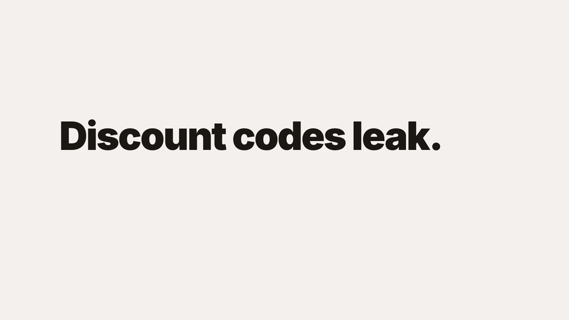
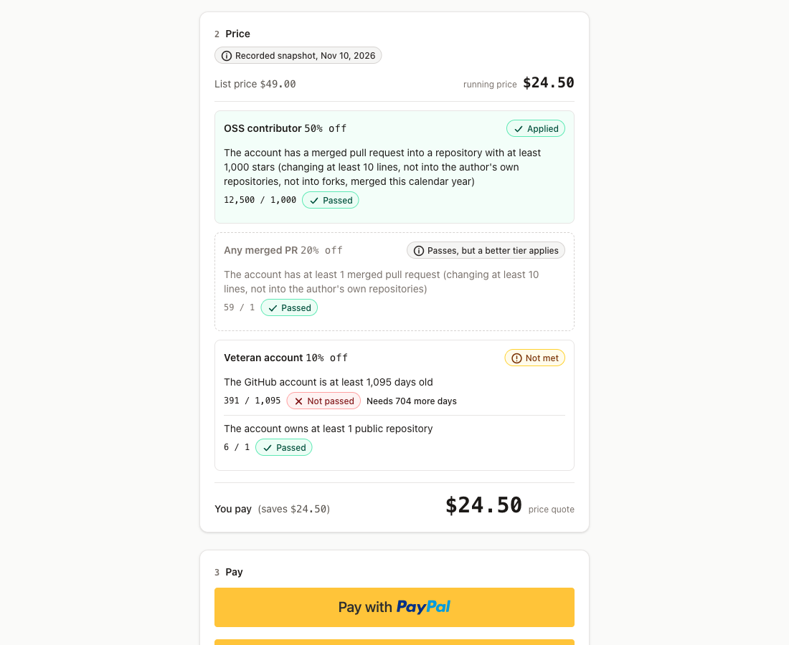
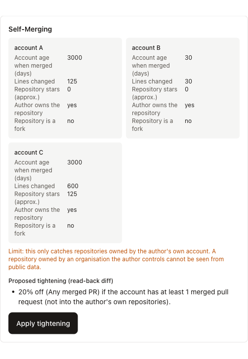
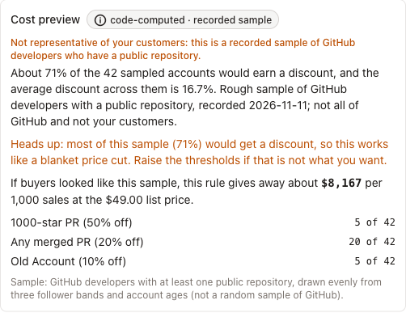

# Earned Price

**Discounts as proofs, not codes.** A merchant writes a discount rule in one sentence, AI red-teams it before launch, and PayPal charges, or refunds, exactly what code computes from the buyer's public GitHub record (or, without an account, from a labelled recorded sample).

**Live demo (PayPal sandbox, no real money): https://earned-price.onrender.com** · MIT licence · built for the PayPal AI Hackathon, Nov 2026

<p align="center">
  <a href="docs/media/earned-price-20s.mp4"></a>
  <br><sub>20-second overview made from the app's real screens (recorded sample profile). Click for the MP4.</sub>
</p>

<p align="center">
  
  
</p>

## Try it (each path takes a few minutes)
1. **Buy at an earned price:** open the shop, pick the "Qualifies" sample (or sign in with GitHub; it asks for no permissions), watch the price tick down, and pay with the sandbox buyer shown on the page.
2. **Buy first, prove later:** continue as a guest, pay $49.00, then claim a refund on the receipt with a sample or your GitHub account; PayPal records the refund.
3. **Be the merchant:** on `/merchant` type any sentence (a live model compiles it) or click an example (a recorded result), run the loophole hunt on the Brief example, apply the tightening, read the cost preview, publish, then open the checkout link in a second browser and click "Start checkout under this rule". Or build a rule by hand with no AI.
4. **Be an agent:** `/agent` shows how to add the read-only MCP server to Claude Code; it reads a rule, previews what a buyer would pay, and never creates an order.

Each sample profile redeems its discount once per browser and each GitHub account once in total; between steps, press "Demo only: release this account's redemption" on the shop page, or use a different sample.

## What happens, in one paragraph
A merchant types one sentence ("half off for anyone with a PR merged into a 1,000-star repo this year; 20% off for any merged PR; 10% off for accounts older than 3 years"). AI compiles it into a typed rule over a fixed whitelist of GitHub facts; code validates the rule and writes its plain-English read-back. Before publishing, the loophole hunt looks for real accounts that would win a tier against the rule's spirit and proposes a tightening that code checks, and a cost preview shows what the rule gives away. A buyer signs in with GitHub (zero OAuth scopes) or picks a labelled sample profile; deterministic code evaluates the rule on the buyer's public GitHub facts, read live when the price is quoted for the account proven at sign-in, and the price ticks down line by line. PayPal charges exactly the earned price, with the discount as its own line. The receipt is read back from PayPal and re-checks a hash of the facts that set the price. A guest who paid full price can prove facts later and get the exact difference refunded through PayPal. Everyone the rule does not cover pays list price.

**Status:** feature-complete and live for judging (submission Nov 12 2026, judging Dec 1–15). PayPal **sandbox only**: the server refuses to start against the live API (`PAYPAL_ENV` must be exactly `sandbox`). Contributor and open-source discounts today usually run on application forms reviewed by hand, or on coupon codes that leak; this is the same idea with the proof built in, and readable by a shopping agent that cannot fill in a form.

## How it works
1. **Merchant** (`/merchant`): one sentence, or a small form with no AI at all, becomes a typed rule over six whitelisted GitHub facts (account age, followers, public repos, commits last year, merged PRs, best repo stars among merged PRs, with PR filters). Code validates it (whitelist, `>=` only, values at least 1, at most 3 tiers, discounts 1–90%) and prints a read-back that code generates. A loophole hunt then looks for real accounts that earn a tier against its spirit (own repos, forks, one-line PRs, brand-new accounts), proposes a tightening that code recomputes and checks, and a cost preview runs the rule over 42 recorded accounts: share that qualifies, average discount, what the rule would give away per 1,000 sales, and a before/after table when a tightening is applied. Publishing is a separate click; it applies to the publisher's browser and gives a checkout link (`/shop/<rule id>`) that anyone can open to be priced under that rule.
2. **Buyer** (`/`): sign in with GitHub (zero OAuth scopes) or pick a recorded sample profile. Code evaluates the rule on the raw facts; the price ticks down line by line (with links to the deciding pull requests when you sign in with GitHub). PayPal charges exactly that price, with the discount as its own line on the order and a plain description of the earned discount in PayPal's own order details.
3. **Receipt** (`/receipt/[id]`): every money figure is read back from PayPal, and the receipt re-hashes the stored facts and compares them with the `custom_id` PayPal holds (`<order id>:<sha256 of the fact snapshot>`). It proves the facts that set the price are the ones stored and tied to PayPal's record; it does not prove GitHub's data was true. No match, no licence. A refund carries `<claim hash>:<our refund attempt id>` (an id we generate before calling PayPal, not PayPal's refund id) so a retry is not mistaken for an earlier attempt (regression tests cover the documented cases).
4. **Buy first, prove later**: a guest pays full price, proves facts afterwards, and the code refunds exactly what was captured minus the price that order's own rule (or the shop default) gives the proven facts; publishing another rule cannot change an existing order's refund, through PayPal (idempotent request id, refund read back, one redemption per buyer).
5. **Agents** (`/agent`, `POST /api/mcp`): a read-only Model Context Protocol interface with three tools: read a rule, preview what a sample or public GitHub login would pay, get the checkout link. It uses no cookie, creates no order and never calls PayPal; paying still needs the buyer's own PayPal approval (and GitHub sign-in for pricing from live facts).

<p align="center">
  
</p>

Where the AI sits: it proposes (compiles a sentence into a rule, proposes loophole strategies that code then searches for and checks). It never sees or sets an amount, and nothing it outputs is executed as a query, a URL or a publish. The agent interface is read-only by design. For the read-back side, PayPal's own MCP server (`@paypal/mcp`, limited to its one read-only tool, `get_order`) lets the same agent read an order back from PayPal: `scripts/paypal-mcp.sh` starts it against the sandbox with a token made fresh from `.env` each session, never pasted or stored. Nothing in the agent path can create, pay or refund.

## Evidence, not claims
- `docs/EVIDENCE.md`: every money feature has a row with the PayPal order, capture and refund ids and the amounts PayPal returned (sandbox): discounted capture, idempotent refunds, redemption limit and reset, buy-then-refund, and purchases on the deployed site signed in with a real GitHub account (at list price, and with a 20% discount earned from live facts).
- Tests: `pnpm test` (about 900 tests, including the agent interface; the money path runs against a real Postgres with PayPal mocked, plus independently written tests from the specs in `docs/specs/`).
- Rule compiler evaluation: on a **held-out set** of 29 fresh sentences written by a different model without seeing the prompt, the local compiler scored **26/29** with one uncheckable sentence leaking (a language condition silently dropped), which is below the evaluation's own pass bar of 27 and was recorded as a fail; that leak was fixed in code and the later 29/29 and 40/40 are development-set numbers, not held-out (`docs/process/L5b-heldout-first-run.md`, `docs/process/L5-compiler-eval.md`). The original 40-case set was used to tune the prompt. The same 29 sentences run against the **hosted model the demo uses** scored 29/29 with no leaks, but that is a development-set number (the fixes followed the first run) and only 20 of the 29 reached the model, because 9 were refused by code first (`docs/process/L5c-heldout-hosted.md`).
- Independent reviews of the money path found real bugs that were fixed with regression tests (stuck captures, a reconcile path that skipped the redemption claim, a refund `custom_id` reuse); an independent red-team pass against the local app (no approved payments, no GitHub sign-in exercised) found no critical or high issue and its fixes are listed in `docs/process/L6-redteam.md`.

## Documents
- [docs/ARCHITECTURE.md](docs/ARCHITECTURE.md) — frozen design: rule type, facts snapshot, money-path state machine, invariants, December-survival table
- [docs/FACTS.md](docs/FACTS.md) — every PayPal / GitHub / hosting fact the design relies on, with source and verification status
- [docs/EVIDENCE.md](docs/EVIDENCE.md) — real sandbox calls (IDs, amounts, dates) read back from PayPal
- [docs/LIMITATIONS.md](docs/LIMITATIONS.md) — every known limit, plainly, with the reasoning
- [docs/DEPLOY.md](docs/DEPLOY.md) — Render + Neon deploy checklist, keep-alive, first checks on the live URL
- [docs/process/PLAN.md](docs/process/PLAN.md) — phases, loops, model orchestration, cut order

## Hard rules
- AI proposes; deterministic code decides everything about money. No model ever sets or sees an amount.
- Every money figure shown after payment is read back from PayPal.
- Nothing simulated is presented as real; cached and recorded data is labelled with its date.
- PayPal sandbox only; no real money.

## Run it locally
```bash
pnpm install
cp .env.example .env   # fill in the keys; docs/DEPLOY.md lists which account gives which key
pnpm db:migrate
pnpm dev               # http://127.0.0.1:3000
```
The merchant compiler uses a local OpenAI-compatible model (Ollama, `AI_BASE_URL` / `AI_MODEL`) in development. The deployed demo runs with `AI_LIVE=1` against a hosted OpenAI-compatible model (capped: 10 live compiles per hour per address and 200 per day in total) and says so plainly when the model does not answer or the cap is reached: a new sentence then gets a "try again later" message, while the example sentences and the Brief example's hunt still answer from recorded, dated results and the hand-built form always works.

## AI tools used (and what each did)
| Tool | Used for |
|---|---|
| Claude Opus 5.5 (Claude Code) | planning, architecture drafting, merging reviews, task specs, integration, simulated judging |
| Claude Sonnet 5.5 | research readers (PayPal docs, GitHub docs, hosting free tiers); main implementer; independent test author; simulated judging |
| Claude Haiku 5.5 | test/lint/typecheck runner; simulated judging |
| Gemma 4 12B (local, Ollama) | development-time rule compiler and loophole proposer, and the held-out compiler evaluation (structured output only, validated by code) |
| DeepSeek V4.1 Flash (hosted on Nebius Token Factory) | the deployed demo's live rule compiler and loophole proposer (`AI_LIVE=1`): it receives the merchant's sentence (to compile) or the rule's plain-English read-back (to hunt), never a price, a buyer's identity or a buyer's facts, and every answer is validated by the same code |
| Claude Fable | independent architecture reviews (two rounds), diff reviews, red-team lead, strategy and market research, simulated judging |
| Claude Opus 4.6 Thinking | simulated judging (second round) |
| Gemini 3.8 Flash | independent architecture critic and code reviewer (different vendor); author of the held-out compiler test sentences; simulated judging |

_This table is updated as tools are actually used; models that were planned but never ran are not listed._

## Limits worth knowing
GitHub is the only fact source (the wedge, not the ceiling). A rule is published per browser or shared by link; there are no merchant accounts. The live AI on the hosted demo is a capped hosted model with recorded results as the fallback, and any rule can be built by hand. Refunds do not return PayPal's fee (on the $49 example the merchant pays $2.20 instead of $1.35, about $0.85 more for proving later). Sample profiles are recorded stand-ins for GitHub sign-in. Everything else, with the reasoning, is in [docs/LIMITATIONS.md](docs/LIMITATIONS.md).

## License
MIT — see [LICENSE](LICENSE).
